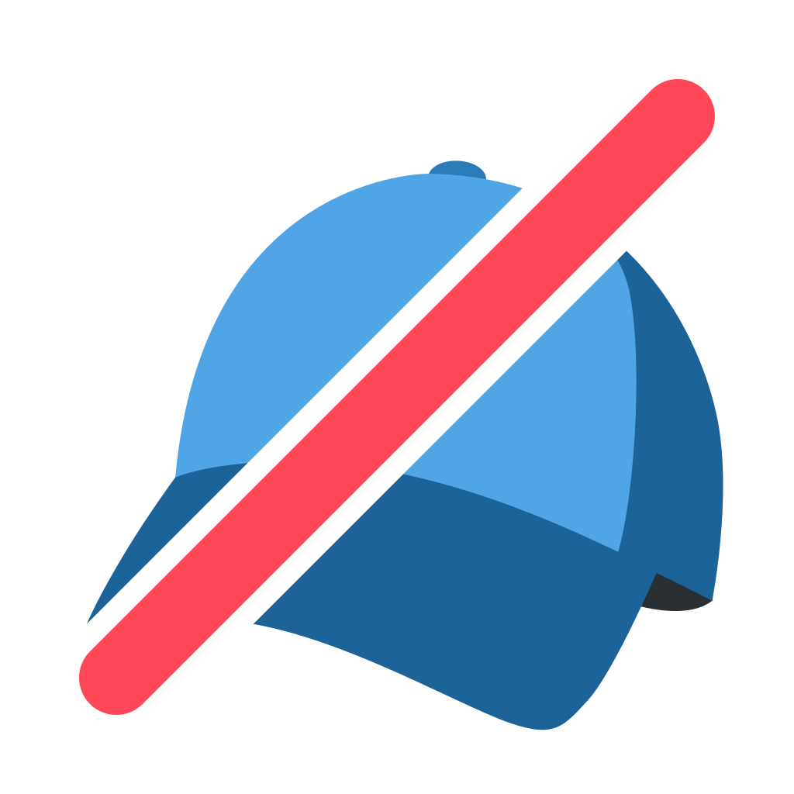
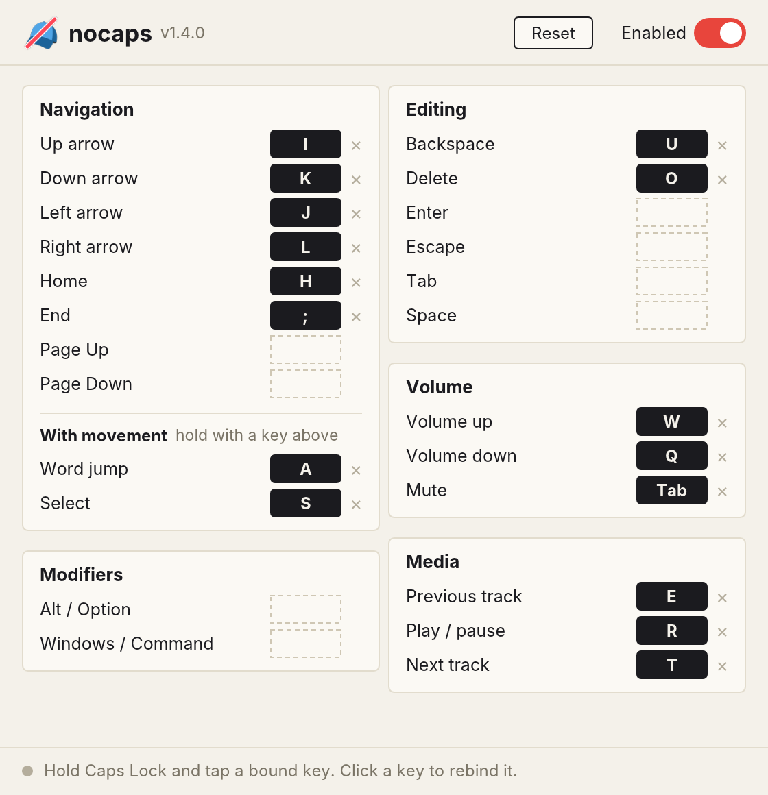

<div align="center">



# nocaps

**Turn Caps Lock into a keyboard layer.** Arrows, editing, modifiers and media on the home row, on Windows, macOS and Linux.

[](https://github.com/brensch/keys/actions/workflows/build.yml)
[](https://github.com/brensch/keys/releases/latest)
[](LICENSE)

[**Windows**](https://github.com/brensch/keys/releases/latest/download/nocaps-windows.exe) ·
**macOS** [Apple Silicon](https://github.com/brensch/keys/releases/latest/download/nocaps-macos-arm64) / [Intel](https://github.com/brensch/keys/releases/latest/download/nocaps-macos-intel) ·
[**Linux**](https://github.com/brensch/keys/releases/latest/download/nocaps-linux)



</div>

## How it works

Hold **Caps Lock** and press a bound key. Caps Lock itself never toggles while nocaps is enabled.

| Hold Caps Lock + | Does | | Hold Caps Lock + | Does |
| :-: | --- | --- | :-: | --- |
| <kbd>I</kbd> <kbd>J</kbd> <kbd>K</kbd> <kbd>L</kbd> | ↑ ← ↓ → | | <kbd>A</kbd> / <kbd>S</kbd> + a movement key | Word jump / Select |
| <kbd>H</kbd> / <kbd>;</kbd> | Home / End | | <kbd>Q</kbd> / <kbd>W</kbd> / <kbd>Tab</kbd> | Volume down / up / mute |
| <kbd>U</kbd> / <kbd>O</kbd> | Backspace / Delete | | <kbd>E</kbd> / <kbd>R</kbd> / <kbd>T</kbd> | Previous / play-pause / next |

Combine freely: Caps Lock + <kbd>A</kbd> + <kbd>J</kbd> jumps a word left, and adding <kbd>S</kbd> selects it. Combos do the same thing on every OS: on macOS words use Option and Home/End become Cmd+←/→.

nocaps runs in the system tray. Choose **Configure** to rebind: click a key, press the new one, and it is applied and saved instantly.

## Install

| | |
| --- | --- |
| **Windows** | Run `nocaps-windows.exe`. To start at sign-in, put it in `shell:startup`. |
| **macOS** | `chmod +x nocaps-macos-* && xattr -d com.apple.quarantine nocaps-macos-*`, run it, then allow it under **System Settings → Privacy & Security → Accessibility**. |
| **Linux** | Needs read access to `/dev/input` and write access to `/dev/uinput`: `sudo usermod -aG input "$USER"`, then sign out and back in. |

## Fast by design

Every platform uses its lowest-level input interface short of a kernel driver: a `WH_KEYBOARD_LL` hook on Windows, a Core Graphics event tap on macOS, and evdev/uinput on Linux. Bindings live in a static table, so each key event costs one memory load: no locks, allocation or lookups. The window does no work while it sits in the tray.

## Details

<details>
<summary>Configuration file</summary>

Changes made in the window are saved as JSON:

- Windows: `%APPDATA%\nocaps\config.json`
- macOS: `~/Library/Application Support/nocaps/config.json`
- Linux: `~/.config/nocaps/config.json`

```json
{
  "version": 1,
  "enabled": true,
  "bindings": { "arrow_up": "i", "left_control": "a", "volume_mute": "tab" }
}
```

Each action takes one key and each key triggers one action. Defaults are compiled in from [`config/default.json`](config/default.json).
</details>

<details>
<summary>macOS and Caps Lock</summary>

macOS latches Caps Lock in its HID driver, below any app, so nocaps uses `hidutil` to remap Caps Lock to F18 while enabled. Disabling or quitting restores your previous mapping. If nocaps is force-killed, Caps Lock acts as F18 until nocaps is next run or the Mac restarts.
</details>

<details>
<summary>Building from source</summary>

```bash
cargo build --release
```

Linux also needs `libgtk-3-dev libayatana-appindicator3-dev`.
</details>

## License

[MIT](LICENSE). Icon cap from [Twemoji](https://github.com/jdecked/twemoji) (CC-BY 4.0); interface font [Inter](https://github.com/rsms/inter) (SIL OFL 1.1).
